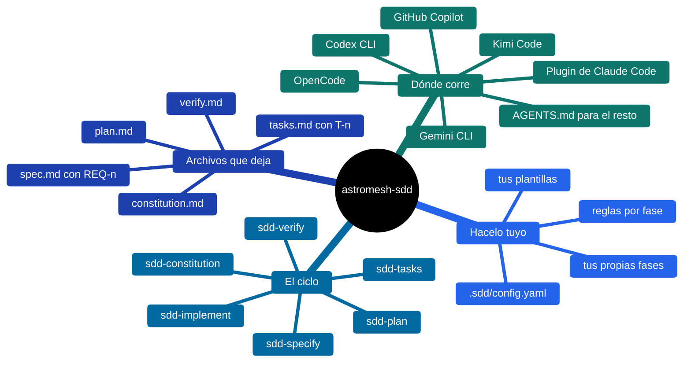
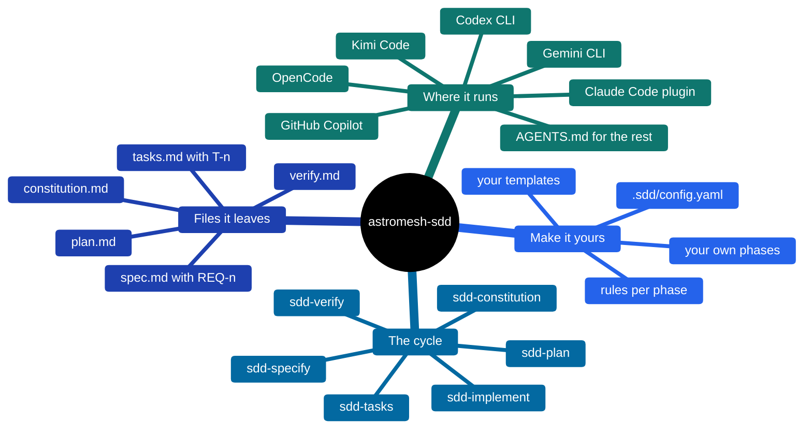
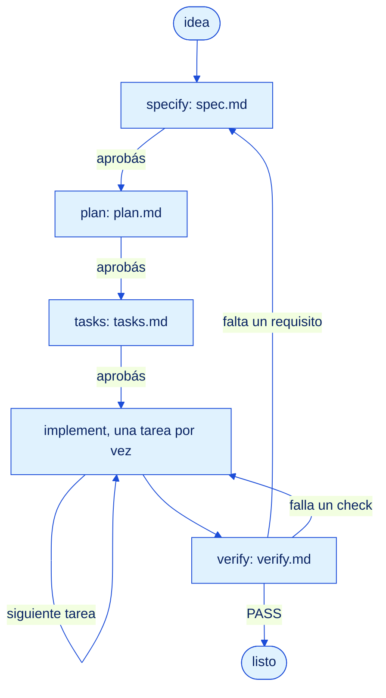

<p align="center">
  
</p>

# astromesh-sdd

**Skills de Spec-Driven Development para cualquier agente de código.**

[](https://monaccode.github.io/astromesh/#ecosystem)
[](https://github.com/monaccode/astromesh-sdd/releases)
[](https://github.com/monaccode/astromesh-sdd/actions/workflows/ci.yml)
[](https://agentskills.io)
[](#claude-code)
[](https://github.com/monaccode/astromesh-sdd/blob/main/LICENSE)

*[Read in English](https://github.com/monaccode/astromesh-sdd/blob/main/README.md)*

Los agentes de código escriben rápido y se olvidan del porqué. Spec-Driven Development
ordena el trabajo: primero una **spec** de lo que tiene que ser cierto, después un **plan**
de cómo, después **tareas** chicas que se pueden verificar, después el código, y al final
una **verificación** contra la spec. `astromesh-sdd` empaqueta ese ciclo en siete skills.
Cada fase escribe un archivo Markdown junto a tu código, así la próxima sesión, alguien de
tu equipo u otro agente retoma exactamente donde quedó la anterior.

Las skills usan el formato abierto [Agent Skills](https://agentskills.io) (`SKILL.md`): la
misma carpeta funciona en Claude Code, Codex CLI, OpenCode, Kimi Code, Gemini CLI y GitHub
Copilot. Los agentes que no leen skills reciben el ciclo completo en un bloque de `AGENTS.md`.



## El ciclo



## The cycle



1. **Specify** — requisitos numerados (`REQ-1`…) con criterios de aceptación
   Given/When/Then. Lo que no se sabe queda marcado `[NEEDS CLARIFICATION]`; nunca se inventa.
2. **Plan** — decisiones con la alternativa descartada, los archivos a tocar, riesgos y cómo
   se prueba cada requisito. Cada paso cita los requisitos que atiende.
3. **Tasks** — tareas chicas y ordenadas (`T-1`…), cada una con un comando que demuestra
   que está hecha.
4. **Implement** — una tarea por vez: test que falla, código mínimo, check en verde, tilde,
   commit. Un requisito nuevo vuelve a la spec antes de entrar al código.
5. **Verify** — corre tu suite de tests en el momento y traza cada requisito a sus tareas y
   su evidencia. PASS sólo cuando no queda nada sin cubrir.

La **constitution** es opcional: una lista corta de principios verificables del proyecto que
toda spec y todo plan tienen que respetar. La skill `sdd` mira qué archivos existen y le dice
al agente qué fase sigue.

## Instalación

```bash
git clone https://github.com/monaccode/astromesh-sdd
cd astromesh-sdd
```

| Agente | Instalar en tu proyecto | Usarlo |
|---|---|---|
| <a id="claude-code"></a>Claude Code | `/plugin marketplace add monaccode/astromesh-sdd`<br/>`/plugin install astromesh-sdd@astromesh` | `/astromesh-sdd:sdd` |
| Codex CLI | `./install.sh --target codex --dir ~/mi-proyecto` | `$sdd` |
| OpenCode | `./install.sh --target opencode --dir ~/mi-proyecto` | pedile la skill `sdd` |
| Kimi Code | `./install.sh --target kimi --dir ~/mi-proyecto` | `/skill:sdd` |
| Gemini CLI | `./install.sh --target gemini --dir ~/mi-proyecto` | se activa sola |
| GitHub Copilot | `./install.sh --target copilot --dir ~/mi-proyecto` | se activa sola |
| Cualquier otro | `./install.sh --target agents-md --dir ~/mi-proyecto` | lee `AGENTS.md` |

`--global` instala para todos tus proyectos. En Windows usá `.\install.ps1` con las mismas
opciones (`-Target`, `-Global`, `-Dir`). Codex, OpenCode, Kimi, Gemini y Copilot leen
`.agents/skills/`, así que una sola instalación sirve para todos; `./install.sh` sin
opciones instala para todos los agentes a la vez. Rutas, cómo invocar y cómo comprobar que
cargó en cada uno: **[docs/install.md](docs/install.md)** (en inglés).

## Hacelo tuyo

Nunca editás las skills que vienen en el paquete. Poné una carpeta `.sdd/` en tu proyecto
(o `~/.sdd/` para todos) — `./install.sh --init` crea una comentada:

- `config.yaml` — dónde viven las specs, en qué idioma se escriben los artefactos, los
  prefijos de IDs, qué fases esperan tu aprobación y qué comando cuenta como evidencia.
- `templates/spec.md` y compañía — tu propio formato de spec, plan, tasks o verify.
- `rules/specify.md`, `rules/all.md` — reglas extra para una fase o para todas.
- Fases nuevas (un ADR, un threat model) — copiá
  [`templates/my-phase`](templates/my-phase/SKILL.md) y agregala en `phases:`.

Recetas y referencia completa: **[docs/extending.md](docs/extending.md)** (en inglés).

## Contribuir

Issues y pull requests son bienvenidos. [CONTRIBUTING.md](CONTRIBUTING.md) explica cómo
correr los checks y cómo sumar una plataforma.

## Licencia

[Apache-2.0](LICENSE). Parte del ecosistema [Astromesh](https://monaccode.github.io/astromesh/).
