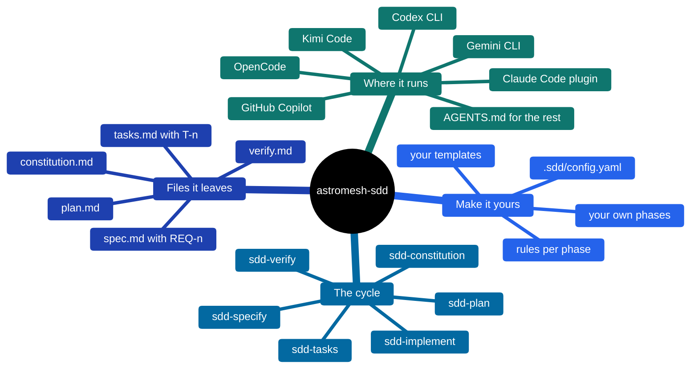
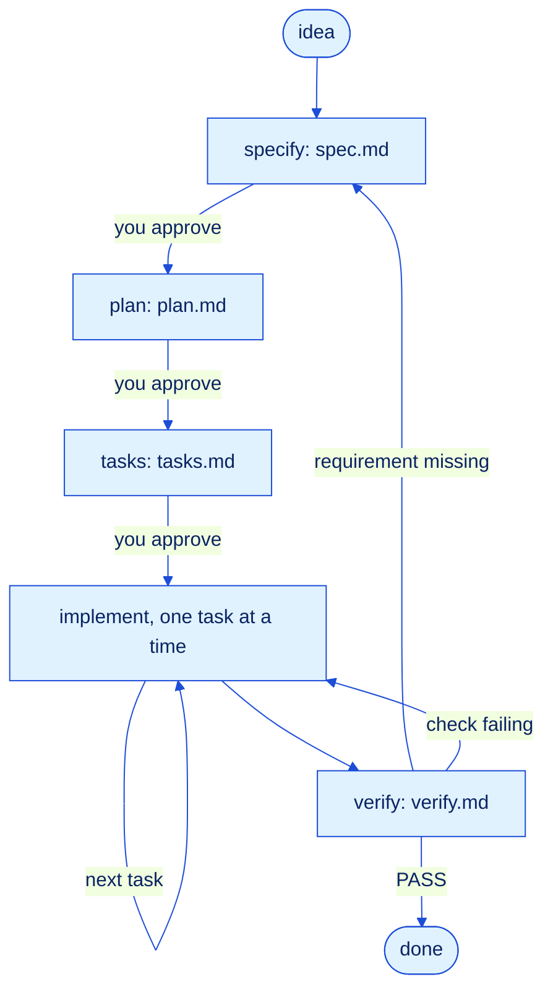

<p align="center">
  
</p>

# astromesh-sdd

**Spec-Driven Development skills for any coding agent.**

[](https://monaccode.github.io/astromesh/#ecosystem)
[](https://github.com/monaccode/astromesh-sdd/releases)
[](https://github.com/monaccode/astromesh-sdd/actions/workflows/ci.yml)
[](https://agentskills.io)
[](#claude-code)
[](https://github.com/monaccode/astromesh-sdd/blob/main/LICENSE)

*[Leer en español](https://github.com/monaccode/astromesh-sdd/blob/main/README.es.md)*

Coding agents are fast at writing code and bad at remembering why. Spec-Driven Development
fixes the order of work: first a **spec** of what must be true, then a **plan** of how,
then **tasks** small enough to check, then the code, then **verification** against the
spec. `astromesh-sdd` packs that cycle into seven skills. Each phase writes a Markdown
file next to your code, so the next session, a teammate or a different agent picks up
exactly where the last one stopped.

The skills use the open [Agent Skills](https://agentskills.io) format (`SKILL.md`), so the
same folder works in Claude Code, Codex CLI, OpenCode, Kimi Code, Gemini CLI and GitHub
Copilot. Agents without skill support get the whole cycle from one `AGENTS.md` block.



## The cycle



1. **Specify** — numbered requirements (`REQ-1`…) with Given/When/Then acceptance.
   Unknowns are marked `[NEEDS CLARIFICATION]`, never guessed.
2. **Plan** — decisions with the alternative rejected, the files to touch, risks, and how
   each requirement will be tested. Every step cites the requirements it serves.
3. **Tasks** — small, ordered tasks (`T-1`…), each with a command that proves it done.
4. **Implement** — one task at a time: failing test, minimum code, passing check, tick,
   commit. A new requirement goes back into the spec before it goes into code.
5. **Verify** — runs your test suite now and traces every requirement to its tasks and
   evidence. PASS only when nothing is uncovered.

The **constitution** is optional: a short list of testable project principles every spec
and plan must respect. The `sdd` skill looks at which files exist and tells the agent
which phase comes next.

## Install

```bash
git clone https://github.com/monaccode/astromesh-sdd
cd astromesh-sdd
```

| Agent | Install into your project | Run it |
|---|---|---|
| <a id="claude-code"></a>Claude Code | `/plugin marketplace add monaccode/astromesh-sdd`<br/>`/plugin install astromesh-sdd@astromesh` | `/astromesh-sdd:sdd` |
| Codex CLI | `./install.sh --target codex --dir ~/my-project` | `$sdd` |
| OpenCode | `./install.sh --target opencode --dir ~/my-project` | ask for the `sdd` skill |
| Kimi Code | `./install.sh --target kimi --dir ~/my-project` | `/skill:sdd` |
| Gemini CLI | `./install.sh --target gemini --dir ~/my-project` | picked up automatically |
| GitHub Copilot | `./install.sh --target copilot --dir ~/my-project` | picked up automatically |
| Anything else | `./install.sh --target agents-md --dir ~/my-project` | reads `AGENTS.md` |

`--global` installs for every project instead. On Windows use `.\install.ps1` with the same
options (`-Target`, `-Global`, `-Dir`). Codex, OpenCode, Kimi, Gemini and Copilot all read
`.agents/skills/`, so one install serves all of them; plain `./install.sh` installs for
every agent at once. Paths, invocation and how to check each one loaded:
**[docs/install.md](docs/install.md)**.

## What a feature looks like

[`examples/specs/001-slugify-title`](examples/specs/001-slugify-title) was produced by these
skills in Claude Code, from a one-line request to a verified feature in four approvals:

```
specs/001-slugify-title/
  spec.md      7 requirements, a Security section (from a project rule), non-goals
  plan.md      decisions, file map, 5 test-first steps, coverage table
  tasks.md     T-1 … T-3, each with its check, all ticked
  verify.md    suite output + traceability, verdict PASS
```

An excerpt of its `verify.md`:

| Requirement | Tasks | Evidence | Status |
|---|---|---|---|
| REQ-2 | T-1 | `test_strips_accents` passed (`"Café Ñandú"` → `"cafe-nandu"`) | ✅ |
| REQ-3 | T-1 | `test_drops_non_ascii` passed (`世界`, `☃`, `ß`/`Ø`) | ✅ |
| REQ-4 | T-2 | `test_removes_punctuation` passed (`"C++ & Rust"` → `"c-rust"`) | ✅ |
| REQ-6 | T-3 | `test_keeps_first_five_words` passed | ✅ |
| REQ-7 | T-3 | `test_empty_result` passed (`"?!... --- ___"` → `""`) | ✅ |

## Make it yours

You never edit the shipped skills. Put a `.sdd/` folder in your project (or `~/.sdd/` for
all of them) — `./install.sh --init` creates a commented one:

- `config.yaml` — where specs live, the language artifacts are written in, ID prefixes,
  which phases wait for your approval, the command that counts as evidence.
- `templates/spec.md` and friends — your own spec, plan, tasks or verify format.
- `rules/specify.md`, `rules/all.md` — extra rules for one phase or all of them.
- New phases (an ADR step, a threat model) — copy
  [`templates/my-phase`](templates/my-phase/SKILL.md) and list it in `phases:`.

Recipes and the full reference: **[docs/extending.md](docs/extending.md)**.

## Contributing

Issues and pull requests are welcome. [CONTRIBUTING.md](CONTRIBUTING.md) explains how to
run the checks and how to add a platform.

## License

[Apache-2.0](LICENSE). Part of the [Astromesh](https://monaccode.github.io/astromesh/)
ecosystem.
