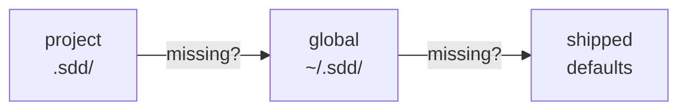

# Customizing and extending astromesh-sdd

You never need to edit the shipped skills. Everything below lives in your project (or your
home directory) and survives updates.

## How settings are found

Every phase skill starts with the same step: load settings, then templates, then rules.



The first one that has the file wins. Missing files are normal. Run
`./install.sh --init` (or `pwsh -File .\install.ps1 -Init`) to get a commented `.sdd/` to start from.

## `.sdd/config.yaml`

| Key | Default | Effect |
|---|---|---|
| `specs_dir` | `specs` | Where feature folders and `constitution.md` live |
| `language` | `en` | Language of every generated artifact |
| `ids.requirement` | `REQ` | Requirement ID prefix (`REQ-1`) |
| `ids.task` | `T` | Task ID prefix (`T-1`) |
| `gates` | `[specify, plan, tasks]` | Phases that stop for your approval. `[]` runs the cycle autonomously |
| `verify_command` | `""` | Command `sdd-verify` and `sdd-implement` run as evidence. Empty: use the constitution's, else ask |
| `phases` | `[constitution, specify, plan, tasks, implement, verify]` | Phase order the `sdd` skill routes through. Add your own |

## Override a template

Copy a shipped template from `skills/<skill>/templates/` to `.sdd/templates/` with the same
name and edit it. Names: `constitution.md`, `spec.md`, `plan.md`, `tasks.md`, `verify.md`.
Keep the `REQ-n` / `T-n` structure — the other phases read it.

## Add rules

`.sdd/rules/all.md` applies to every phase; `.sdd/rules/<phase>.md` to one (`specify`,
`plan`, `tasks`, `implement`, `verify`, `constitution`, or a custom phase). Rules add to the
skill, and win where they conflict with it. Write them as short, checkable bullets.

## Add a phase

1. Copy [`templates/my-phase/`](../templates/my-phase/SKILL.md) to a new folder named after
   your phase, e.g. `sdd-adr/`, and set `name: sdd-adr` in its frontmatter.
2. Say what it reads and the one file it writes in the feature folder — the `sdd` skill
   treats the phase as done when that file exists.
3. Install it next to the others (`.claude/skills/`, `.agents/skills/`, or both).
4. Add it to `phases:` in the order it should run.

## Recipes

### 1. Every spec has a security section

`.sdd/rules/specify.md`:

```markdown
- Every spec includes a `## Security` section after Requirements: which data the feature
  reads or writes, who can access it, and what happens if an unauthorized user tries.
```

Optionally add `.sdd/rules/verify.md`: "Verification checks every statement in the
Security section and lists the evidence."

### 2. Artifacts in Spanish

`.sdd/config.yaml`:

```yaml
language: es
```

Skills stay in English; specs, plans, tasks and reports come out in Spanish. To translate
the headings too, override the templates in `.sdd/templates/`.

### 3. An ADR phase between specify and plan

`.sdd/config.yaml`:

```yaml
phases: [constitution, specify, adr, plan, tasks, implement, verify]
```

`.claude/skills/sdd-adr/SKILL.md` (and/or `.agents/skills/sdd-adr/SKILL.md`):

```markdown
---
name: sdd-adr
description: Use when a spec is approved and the feature involves an architectural choice (new dependency, data store, protocol or service boundary) that has no ADR yet.
---

# SDD — Architecture Decision Record

## Step 0 — Load project settings

Before anything else, read these if they exist. Missing files are normal; use the defaults.
(Same three steps as the shipped skills: `.sdd/config.yaml`, templates, `.sdd/rules/all.md`
and `.sdd/rules/adr.md`.)

## Steps

1. Read `spec.md`. List the decisions it forces (at most 3).
2. For each: context, options considered (at least two), decision, consequences.
3. Write `<specs_dir>/NNN-<slug>/adr.md`. The plan must follow it.

## Gate

If `adr` is in `gates`, show `adr.md` and stop until the user approves.
```
