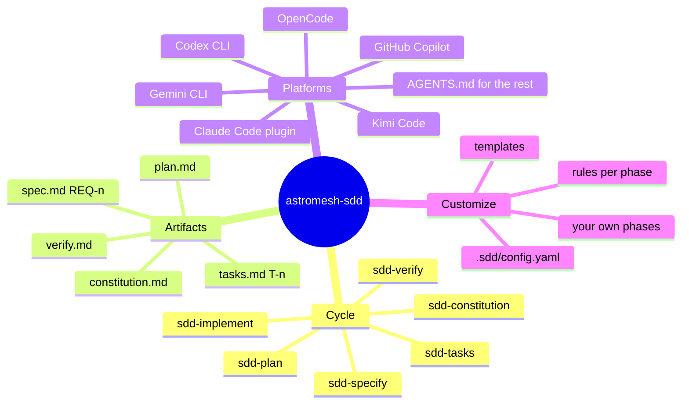

# astromesh-sdd Implementation Plan

> **For agentic workers:** REQUIRED SUB-SKILL: Use superpowers:subagent-driven-development (recommended) or superpowers:executing-plans to implement this plan task-by-task. Steps use checkbox (`- [ ]`) syntax for tracking. When writing any `SKILL.md`, also follow superpowers:writing-skills.

**Goal:** Ship `astromesh-sdd` v0.1.0: seven portable Spec-Driven Development skills, packaged as a Claude Code plugin + marketplace, with installers, install/extension docs, brand assets and CI, in a public GitHub repo.

**Architecture:** `skills/` is the single source of truth in the open Agent Skills format. The repo root doubles as a Claude Code plugin and a one-plugin marketplace. Two shell installers copy `skills/` to `.claude/skills` and/or `.agents/skills` (read by Codex, OpenCode, Kimi, Gemini, Copilot) and can write an `AGENTS.md` block. Customization is by convention: every phase skill first loads `.sdd/` settings.

**Tech Stack:** Markdown + YAML frontmatter, POSIX `sh`, PowerShell 7, Python 3 stdlib (+ PyYAML for one check), GitHub Actions, Mermaid, SVG.

**Spec:** `docs/superpowers/specs/2026-10-13-astromesh-sdd-design.md`

## Global Constraints

- Repo: `monaccode/astromesh-sdd`, **public**, license Apache-2.0, default branch `main`.
- All shipped content in English; `README.es.md` is the only Spanish file.
- Skill names: `sdd`, `sdd-constitution`, `sdd-specify`, `sdd-plan`, `sdd-tasks`, `sdd-implement`, `sdd-verify`.
- Frontmatter: `name` equals folder name, matches `^[a-z0-9]+(-[a-z0-9]+)*$`, ≤ 64 chars; `description` 1–1024 chars. Only `name` and `description` keys (portable subset).
- Artifacts: `specs/NNN-<slug>/{spec,plan,tasks,verify}.md`, `specs/constitution.md`; IDs `REQ-n`, `T-n`; never renumber.
- Settings precedence: project `.sdd/` > global `~/.sdd/` > shipped defaults.
- Default gates: `[specify, plan, tasks]`.
- Install paths (verified 2026-10-13): `claude` → `.claude/skills` / `~/.claude/skills`; `agents` → `.agents/skills` / `~/.agents/skills`; `agents-md` → `AGENTS.md` block between `<!-- astromesh-sdd:start -->` and `<!-- astromesh-sdd:end -->`. Aliases `codex|opencode|kimi|gemini|copilot` → `agents`.
- Claude plugin name `astromesh-sdd`; marketplace name `astromesh`; install id `astromesh-sdd@astromesh`.
- No dependencies for users. Installers use only `sh`/`pwsh` built-ins + `cp`/`ln`/`mkdir`.
- Logo palette from `astromesh-okf/assets/logo-mark.svg`: `#1e40af`, `#1fb4f2`, `#1d4ed8`, `#0ea5e9`, `#2563eb`, `#f0f9ff`.
- Commit style: conventional commits, each ending `Co-Authored-By: Claude Opus 5.5 <noreply@anthropic.com>`.

## Review Focus

1. **Re-running the installer** over an existing install must update skills and leave a user's `.sdd/` and the non-marked part of `AGENTS.md` untouched → Task 6 test `rerun_preserves_user_files`.
2. **Paths with spaces** in the project dir must install correctly → Task 6 test `path_with_spaces`.
3. **A spec gets a new requirement mid-implementation** — skill must append `REQ-n+1`, not renumber → Task 3 rule + Task 2 check `NO_RENUMBER` phrase present in specify/implement skills.
4. **A project with no `.sdd/` at all** must work with defaults, never error → every phase skill's "Load project settings" step says "missing files are normal"; Task 2 check asserts the phrase.
5. **`--link` install then deleting the clone** leaves dangling links → installer prints a warning when `--link` is used; Task 6 test `link_warns`.

---

## File map

| File | Responsibility | Task |
|---|---|---|
| `LICENSE`, `.gitignore`, `.claude-plugin/{plugin,marketplace}.json` | package identity | 1 |
| `scripts/check.py`, `tests/test_check.py` | repo validator used by CI | 1, extended in 2 |
| `skills/sdd/SKILL.md` | cycle overview + router | 2 |
| `skills/sdd-constitution/{SKILL.md,templates/constitution.md}` | project principles | 2 |
| `skills/sdd-specify/{SKILL.md,templates/spec.md}` | spec phase | 3 |
| `skills/sdd-plan/…`, `skills/sdd-tasks/…` | plan + tasks phases | 4 |
| `skills/sdd-implement/SKILL.md`, `skills/sdd-verify/…` | build + verify phases | 5 |
| `install.sh`, `tests/install_test.sh` | POSIX installer | 6 |
| `install.ps1`, `tests/install_test.ps1` | Windows installer | 7 |
| `AGENTS.md`, `templates/my-phase/SKILL.md`, `examples/.sdd/**`, `docs/extending.md` | portability + extension | 8 |
| `assets/logo-mark.svg`, `assets/logo.svg`, `assets/logo.png`, `assets/icon.png` | brand | 9 |
| `README.md`, `README.es.md`, `docs/install.md`, `CONTRIBUTING.md`, `CHANGELOG.md` | docs | 10 |
| `.github/workflows/{ci,release}.yml` | CI | 11 |
| `examples/specs/001-*/**` | dogfood worked example | 12 |

---

### Task 1: Package identity + validator

**Files:**
- Create: `LICENSE` (Apache-2.0 full text, copy from `../astromesh-okf/LICENSE`), `.gitignore`, `.claude-plugin/plugin.json`, `.claude-plugin/marketplace.json`, `scripts/check.py`, `tests/test_check.py`

**Interfaces:**
- Produces: `python3 scripts/check.py [root]` → exit 0 and prints `ok: N skills` or exit 1 and one `ERROR <path>: <reason>` line per problem. Functions `parse_frontmatter(text) -> dict[str,str]`, `check_skill(dir: Path) -> list[str]`, `check_repo(root: Path) -> list[str]`.

- [ ] **Step 1: Write the failing test** — `tests/test_check.py`:

```python
import sys, tempfile, unittest
from pathlib import Path

sys.path.insert(0, str(Path(__file__).resolve().parents[1] / "scripts"))
import check  # noqa: E402


def make_skill(root: Path, folder: str, text: str) -> Path:
    d = root / "skills" / folder
    d.mkdir(parents=True)
    (d / "SKILL.md").write_text(text)
    return d


GOOD = "---\nname: sdd-x\ndescription: Use when testing.\n---\n\n# X\n"


class CheckSkill(unittest.TestCase):
    def setUp(self):
        self.root = Path(tempfile.mkdtemp())

    def test_good_skill_passes(self):
        self.assertEqual(check.check_skill(make_skill(self.root, "sdd-x", GOOD)), [])

    def test_name_must_match_folder(self):
        errs = check.check_skill(make_skill(self.root, "sdd-y", GOOD))
        self.assertTrue(any("folder" in e for e in errs))

    def test_bad_name_pattern(self):
        text = GOOD.replace("sdd-x", "sdd--x")
        errs = check.check_skill(make_skill(self.root, "sdd--x", text))
        self.assertTrue(any("pattern" in e for e in errs))

    def test_missing_description(self):
        errs = check.check_skill(make_skill(self.root, "sdd-x", "---\nname: sdd-x\n---\n"))
        self.assertTrue(any("description" in e for e in errs))

    def test_description_too_long(self):
        text = GOOD.replace("Use when testing.", "a" * 1025)
        errs = check.check_skill(make_skill(self.root, "sdd-x", text))
        self.assertTrue(any("1024" in e for e in errs))

    def test_no_frontmatter(self):
        errs = check.check_skill(make_skill(self.root, "sdd-x", "# X\n"))
        self.assertTrue(any("frontmatter" in e for e in errs))

    def test_extra_keys_rejected(self):
        text = GOOD.replace("---\n\n", "license: MIT\n---\n\n")
        errs = check.check_skill(make_skill(self.root, "sdd-x", text))
        self.assertTrue(any("license" in e for e in errs))


if __name__ == "__main__":
    unittest.main()
```

- [ ] **Step 2: Run it, expect failure**

Run: `python3 -m unittest tests/test_check.py -v`
Expected: `ModuleNotFoundError: No module named 'check'`

- [ ] **Step 3: Implement `scripts/check.py`**

```python
"""Validate astromesh-sdd: skill frontmatter, manifests, example config."""

import json
import re
import sys
from pathlib import Path

NAME_RE = re.compile(r"^[a-z0-9]+(-[a-z0-9]+)*$")
ALLOWED_KEYS = {"name", "description"}


def parse_frontmatter(text: str) -> dict[str, str] | None:
    if not text.startswith("---\n"):
        return None
    end = text.find("\n---", 4)
    if end == -1:
        return None
    out = {}
    for line in text[4:end].splitlines():
        if line.strip():
            key, _, value = line.partition(":")
            out[key.strip()] = value.strip().strip('"')
    return out


def check_skill(d: Path) -> list[str]:
    p = d / "SKILL.md"
    fm = parse_frontmatter(p.read_text())
    if fm is None:
        return [f"ERROR {p}: missing YAML frontmatter"]
    errs = []
    name, desc = fm.get("name", ""), fm.get("description", "")
    if name != d.name:
        errs.append(f"ERROR {p}: name '{name}' must equal folder '{d.name}'")
    if not NAME_RE.match(name) or len(name) > 64:
        errs.append(f"ERROR {p}: name '{name}' must match {NAME_RE.pattern}, <= 64 chars")
    if not 1 <= len(desc) <= 1024:
        errs.append(f"ERROR {p}: description must be 1-1024 chars (got {len(desc)})")
    for key in sorted(set(fm) - ALLOWED_KEYS):
        errs.append(f"ERROR {p}: key '{key}' is not portable; use only name, description")
    return errs


def check_repo(root: Path) -> list[str]:
    errs = []
    skills = sorted(p.parent for p in (root / "skills").glob("*/SKILL.md"))
    if not skills:
        errs.append(f"ERROR {root / 'skills'}: no skills found")
    for d in skills:
        errs += check_skill(d)
    for rel in (".claude-plugin/plugin.json", ".claude-plugin/marketplace.json"):
        try:
            json.loads((root / rel).read_text())
        except (OSError, ValueError) as e:
            errs.append(f"ERROR {rel}: {e}")
    return errs


def main() -> int:
    root = Path(sys.argv[1] if len(sys.argv) > 1 else ".")
    errs = check_repo(root)
    for e in errs:
        print(e)
    if not errs:
        print(f"ok: {len(list((root / 'skills').glob('*/SKILL.md')))} skills")
    return 1 if errs else 0


if __name__ == "__main__":
    sys.exit(main())
```

- [ ] **Step 4: Manifests**

`.claude-plugin/plugin.json`:
```json
{
  "name": "astromesh-sdd",
  "version": "0.1.0",
  "description": "Spec-Driven Development for coding agents: specify, plan, tasks, implement, verify — with traceable artifacts on disk.",
  "author": { "name": "Juan Carlos Romero", "url": "https://github.com/monaccode" },
  "homepage": "https://github.com/monaccode/astromesh-sdd",
  "repository": "https://github.com/monaccode/astromesh-sdd",
  "license": "Apache-2.0",
  "keywords": ["sdd", "spec-driven-development", "agent-skills", "planning", "astromesh"]
}
```

`.claude-plugin/marketplace.json`:
```json
{
  "name": "astromesh",
  "description": "Astromesh plugins for coding agents",
  "owner": { "name": "monaccode", "url": "https://github.com/monaccode" },
  "plugins": [
    {
      "name": "astromesh-sdd",
      "source": "./",
      "description": "Spec-Driven Development skills: specify, plan, tasks, implement, verify."
    }
  ]
}
```

`.gitignore`: `__pycache__/`, `.DS_Store`, `.superpowers/`, `/tmp-*/`.

- [ ] **Step 5: Run tests, expect pass**

Run: `python3 -m unittest tests/test_check.py -v` → 7 tests OK.
Run: `python3 scripts/check.py .` → `ERROR …/skills: no skills found`, exit 1 (expected until Task 2).

- [ ] **Step 6: Commit**

```bash
git add LICENSE .gitignore .claude-plugin scripts tests
git commit -m "feat: package identity, Claude plugin + marketplace manifests, repo validator"
```

---

### Shared block — "Load project settings"

Every phase skill (`sdd-constitution`, `sdd-specify`, `sdd-plan`, `sdd-tasks`, `sdd-implement`, `sdd-verify`) starts its body with this section **verbatim**, with `<phase>` and `<template>` substituted. Task 2 adds a check that enforces it.

```markdown
## Step 0 — Load project settings

Before anything else, read these if they exist. Missing files are normal; use the defaults.

1. `.sdd/config.yaml` in the project, else `~/.sdd/config.yaml`. Defaults:
   `specs_dir: specs`, `language: en`, `ids: {requirement: REQ, task: T}`,
   `gates: [specify, plan, tasks]`, `verify_command: ""`,
   `phases: [constitution, specify, plan, tasks, implement, verify]`.
2. Template: `.sdd/templates/<template>.md`, else `~/.sdd/templates/<template>.md`,
   else `templates/<template>.md` next to this file.
3. Extra rules: `.sdd/rules/all.md` and `.sdd/rules/<phase>.md` (project, then global).
   They add to this skill; when they conflict with it, they win.

Write every artifact in `language`. Use the configured ID prefixes everywhere this skill
says `REQ` or `T`.
```

`sdd-implement` has no template: its Step 0 omits item 2 and renumbers.

### Shared block — "Gate"

Phase skills whose phase can be gated end with:

```markdown
## Gate

If `<phase>` is in `gates`: show the user the artifact path and a 3–5 line summary, list any
`[NEEDS CLARIFICATION]` items, and **stop**. Do not start the next phase until the user
approves. If it is not in `gates`, say which phase runs next and continue.
```

---

### Task 2: Index skill + constitution, and content checks

**Files:**
- Create: `skills/sdd/SKILL.md`, `skills/sdd-constitution/SKILL.md`, `skills/sdd-constitution/templates/constitution.md`
- Modify: `scripts/check.py` (add `check_content`), `tests/test_check.py`

**Interfaces:**
- Consumes: `check_repo`, `parse_frontmatter` (Task 1)
- Produces: `check_content(root: Path) -> list[str]` enforcing: every `skills/sdd-*/SKILL.md` contains `## Step 0 — Load project settings` and `Missing files are normal`; every skill whose folder has `templates/` references each template file name; `skills/sdd-specify` and `skills/sdd-implement` contain `never renumber`.

- [ ] **Step 1: Failing tests** — append to `tests/test_check.py`:

```python
STEP0 = "## Step 0 — Load project settings\nMissing files are normal.\n"


class CheckContent(unittest.TestCase):
    def setUp(self):
        self.root = Path(tempfile.mkdtemp())

    def test_phase_skill_without_step0_fails(self):
        make_skill(self.root, "sdd-plan", GOOD.replace("sdd-x", "sdd-plan"))
        self.assertTrue(any("Step 0" in e for e in check.check_content(self.root)))

    def test_phase_skill_with_step0_passes(self):
        make_skill(self.root, "sdd-plan", GOOD.replace("sdd-x", "sdd-plan") + STEP0)
        self.assertEqual(check.check_content(self.root), [])

    def test_unreferenced_template_fails(self):
        d = make_skill(self.root, "sdd-plan", GOOD.replace("sdd-x", "sdd-plan") + STEP0)
        (d / "templates").mkdir()
        (d / "templates" / "plan.md").write_text("# Plan\n")
        self.assertTrue(any("plan.md" in e for e in check.check_content(self.root)))

    def test_specify_must_forbid_renumbering(self):
        make_skill(self.root, "sdd-specify", GOOD.replace("sdd-x", "sdd-specify") + STEP0)
        self.assertTrue(any("renumber" in e for e in check.check_content(self.root)))

    def test_index_skill_is_exempt(self):
        make_skill(self.root, "sdd", GOOD.replace("sdd-x", "sdd"))
        self.assertEqual(check.check_content(self.root), [])
```

- [ ] **Step 2: Run, expect `AttributeError: module 'check' has no attribute 'check_content'`**

Run: `python3 -m unittest tests/test_check.py -v`

- [ ] **Step 3: Implement** — add to `scripts/check.py` and call it from `check_repo` (`errs += check_content(root)`):

```python
NO_RENUMBER_SKILLS = {"sdd-specify", "sdd-implement"}


def check_content(root: Path) -> list[str]:
    errs = []
    for p in sorted((root / "skills").glob("sdd-*/SKILL.md")):
        text, name = p.read_text(), p.parent.name
        if "## Step 0 — Load project settings" not in text or "Missing files are normal" not in text:
            errs.append(f"ERROR {p}: missing the shared 'Step 0 — Load project settings' block")
        for t in sorted((p.parent / "templates").glob("*.md")):
            if t.name not in text:
                errs.append(f"ERROR {p}: template {t.name} is never referenced")
        if name in NO_RENUMBER_SKILLS and "never renumber" not in text:
            errs.append(f"ERROR {p}: must state that IDs never renumber")
    return errs
```

- [ ] **Step 4: Run tests → all pass.**

- [ ] **Step 5: Write `skills/sdd/SKILL.md`** (index; no Step 0, no gate). Frontmatter:

```yaml
---
name: sdd
description: Use when starting or resuming any feature with Spec-Driven Development, or when unsure which SDD phase comes next. Explains the cycle and routes to sdd-specify, sdd-plan, sdd-tasks, sdd-implement or sdd-verify based on which files exist.
---
```

Body must contain, in order:
1. One-paragraph definition: spec → plan → tasks → implement → verify; each phase leaves a file; the files are the shared memory between sessions, people and agents.
2. The artifact tree exactly as in the spec section 1.
3. **Routing table** — read `.sdd/config.yaml` for `specs_dir` and `phases`; find the feature dir (the one the user names, else the highest `NNN`); then: no dir → `sdd-specify`; `spec.md` only → `sdd-plan`; `plan.md` without `tasks.md` → `sdd-tasks`; `tasks.md` with any `- [ ]` → `sdd-implement`; all ticked and no `verify.md` → `sdd-verify`; `verify.md` with all REQs covered → done. Custom phases in `phases:` are routed in list order: a custom phase is "done" when the file its skill says it writes exists.
4. The four cross-cutting rules (human gate, traceability, spec first, one task at a time) — one short paragraph each.
5. "Customizing" — 5 lines pointing at `.sdd/config.yaml`, `.sdd/templates/`, `.sdd/rules/`, and `docs/extending.md` in the repo URL.

- [ ] **Step 6: Write `skills/sdd-constitution/SKILL.md`**. Description: `Use when a project has no specs/constitution.md yet, or the user wants to set project-wide engineering principles that every SDD spec and plan must respect.` Body: Step 0 (phase `constitution`, template `constitution`); then: read README, build files, CI config, existing lint/test setup; draft 5–9 principles, each **testable** (a reviewer can say yes/no) with a one-line "why"; record detected stack and test command (suggest it as `verify_command`); write `<specs_dir>/constitution.md` from `constitution.md`; if the file exists, propose a diff instead of overwriting. No gate block (constitution is not in default gates) but always show the result.

`skills/sdd-constitution/templates/constitution.md`:

```markdown
# Constitution — <project>

> Principles every spec, plan and task in this repo must respect. Changing one is a
> reviewed decision: edit this file in its own commit.

## Stack
- Language / runtime:
- Test command:
- Lint / format command:

## Principles

### P1 — <short name>
<one testable rule>
*Why:* <one line>

## Amendments
| Date | Principle | Change | Why |
|---|---|---|---|
```

- [ ] **Step 7: Validate and commit**

Run: `python3 -m unittest tests/test_check.py -v && python3 scripts/check.py .` → tests OK, `ok: 2 skills`.

```bash
git add skills scripts tests
git commit -m "feat: sdd index skill, sdd-constitution, shared-block content checks"
```

---

### Task 3: `sdd-specify`

**Files:** Create `skills/sdd-specify/SKILL.md`, `skills/sdd-specify/templates/spec.md`

- [ ] **Step 1: Frontmatter**

```yaml
---
name: sdd-specify
description: Use when the user describes a new feature, change or product idea and no spec exists for it yet, or when a requirement must be added or changed. Writes specs/NNN-slug/spec.md with numbered, testable requirements and marks open questions instead of guessing.
---
```

- [ ] **Step 2: Body**, in order:
1. Step 0 (phase `specify`, template `spec`) — shared block.
2. **Find or create the feature dir:** next `NNN` = highest existing three-digit prefix in `specs_dir` + 1 (start `001`); slug = kebab-case, ≤ 5 words, from the title. If the user points at an existing spec, go to "Changing a spec".
3. **Read context:** `constitution.md` if present; relevant code only as needed to understand the domain — the spec says *what* and *why*, never *how*.
4. **Ask, don't invent:** at most 3 questions, one at a time, for things that change scope. Everything else unknown goes in the spec as `[NEEDS CLARIFICATION: question]`.
5. **Write `spec.md`** from `spec.md` template. Rules: each requirement is `REQ-n`, one sentence, observable behavior, with ≥ 1 acceptance criterion in Given/When/Then; non-goals listed explicitly; no file names, frameworks or APIs unless the user mandated them.
6. **Self-check before the gate:** every REQ testable? any requirement hiding two? any implementation detail? any contradiction with the constitution? Fix inline.
7. **Changing a spec:** add new requirements as the next free `REQ-n`; never renumber or reuse an ID; mark removed ones `~~REQ-4~~ (removed YYYY-MM-DD: reason)`; add a line to the Changelog section. If `plan.md`/`tasks.md` exist, list which steps cite the changed REQs so the plan can be updated.
8. Gate block (phase `specify`).

- [ ] **Step 3: Template `skills/sdd-specify/templates/spec.md`**

```markdown
# <NNN> — <Title>

**Status:** draft | approved · **Date:** YYYY-MM-DD

## Problem
<who has the problem, what it costs them today — 2–4 sentences>

## Goals
- <outcome, not feature>

## Non-goals
- <explicitly out of scope>

## Requirements

### REQ-1 — <short name>
<one sentence: the system does X when Y>

**Acceptance**
- Given <state>, when <action>, then <observable result>

## Open questions
- [NEEDS CLARIFICATION: …]

## Changelog
| Date | Change |
|---|---|
```

- [ ] **Step 4: Validate and commit**

Run: `python3 scripts/check.py .` → `ok: 3 skills`
```bash
git add skills/sdd-specify && git commit -m "feat: sdd-specify skill and spec template"
```

---

### Task 4: `sdd-plan` and `sdd-tasks`

**Files:** Create `skills/sdd-plan/{SKILL.md,templates/plan.md}`, `skills/sdd-tasks/{SKILL.md,templates/tasks.md}`

- [ ] **Step 1: `sdd-plan` frontmatter**

```yaml
---
name: sdd-plan
description: Use when a feature's spec.md is approved and there is no plan.md yet, or the spec changed after planning. Explores the codebase and writes plan.md - architecture decisions, files to touch, risks - where every step cites the requirements it serves.
---
```

Body: Step 0 (phase `plan`, template `plan`); refuse to proceed if `spec.md` has unresolved `[NEEDS CLARIFICATION]` — ask them first; read constitution + spec + the code the change touches (trace the real flow end to end); write decisions with the alternative rejected and why; **file map** (path, create/modify, responsibility); ordered steps each citing ≥ 1 `REQ-n`; risks + how each is detected; test strategy per REQ; final **coverage check**: list every REQ and the steps that cite it — any REQ with none is a blocker to fix before the gate. Gate block (phase `plan`).

Template `plan.md`:

```markdown
# Plan — <NNN> <Title>

**Spec:** ./spec.md · **Date:** YYYY-MM-DD

## Approach
<2–4 sentences>

## Decisions
| Decision | Rejected alternative | Why |
|---|---|---|

## File map
| Path | Change | Responsibility |
|---|---|---|

## Steps
1. <step> — REQ-1

## Risks
| Risk | How we would notice | Mitigation |
|---|---|---|

## Test strategy
| Requirement | How it is verified |
|---|---|
| REQ-1 | |

## Coverage
| Requirement | Steps |
|---|---|
| REQ-1 | 1 |
```

- [ ] **Step 2: `sdd-tasks` frontmatter**

```yaml
---
name: sdd-tasks
description: Use when plan.md is approved and tasks.md does not exist yet. Breaks the plan into small, ordered, independently verifiable tasks, each citing its requirements and naming the exact check that proves it done.
---
```

Body: Step 0 (phase `tasks`, template `tasks`); each task = one reviewable unit (fold setup/docs into the task that needs them); format `- [ ] T-n — <imperative title> (REQ-a, REQ-b)` followed by indented `files:`, `check:` (a runnable command or an observable manual step), `depends:`; tests come in the same task as the code they test, written first; mark tasks that can run in parallel with `[P]`; end with a coverage table REQ → tasks; every REQ must appear. Gate block (phase `tasks`).

Template `tasks.md`:

```markdown
# Tasks — <NNN> <Title>

**Plan:** ./plan.md · **Spec:** ./spec.md

- [ ] T-1 — <title> (REQ-1)
  - files: `<path>`
  - check: `<command>` → <expected>
  - depends: —

## Coverage
| Requirement | Tasks |
|---|---|
| REQ-1 | T-1 |
```

- [ ] **Step 3: Validate and commit** — `python3 scripts/check.py .` → `ok: 5 skills`.
```bash
git add skills/sdd-plan skills/sdd-tasks && git commit -m "feat: sdd-plan and sdd-tasks skills with templates"
```

---

### Task 5: `sdd-implement` and `sdd-verify`

**Files:** Create `skills/sdd-implement/SKILL.md`, `skills/sdd-verify/{SKILL.md,templates/verify.md}`

- [ ] **Step 1: `sdd-implement`**

```yaml
---
name: sdd-implement
description: Use when tasks.md exists with unchecked tasks. Implements exactly one task at a time - test first where the check is a test - runs its check, and only then ticks it. Sends any new or changed requirement back to the spec before coding it.
---
```

Body: Step 0 (phase `implement`, no template); pick the first unticked task whose `depends` are ticked (or the one the user names); read its REQs from the spec; if the check is a test, write it and see it fail first; implement the minimum; run the task's `check:` and paste the real output summary; tick only on a passing check, appending `— done YYYY-MM-DD`; **spec first**: if the work reveals a missing/changed requirement, stop, add it via sdd-specify's "Changing a spec" rules (next free ID, never renumber), update plan/tasks, then continue; one commit per task referencing `T-n`; after each task report progress `k/N` and continue unless the user asked to pause. Never tick a task whose check was not run.

- [ ] **Step 2: `sdd-verify`**

```yaml
---
name: sdd-verify
description: Use when every task in tasks.md is checked, or before calling a feature done, merging or releasing. Runs the verify command, traces every requirement to its tasks and real evidence, and writes verify.md - flagging anything uncovered instead of passing it.
---
```

Body: Step 0 (phase `verify`, template `verify`); run `verify_command` (if empty, use the constitution's test command, else ask) and keep the real output tail; for each REQ: tasks that cite it, evidence (test name + result, or manual check performed now with what was observed); status ✅ covered / ⚠️ partial / ❌ uncovered; also list tasks citing no REQ (scope creep) and unticked tasks; verdict **PASS** only if every non-removed REQ is ✅ and the command passed; write `verify.md` from `verify.md`; on FAIL, list the next actions (which phase to go back to). Never mark ✅ without evidence produced in this run.

Template `verify.md`:

```markdown
# Verification — <NNN> <Title>

**Date:** YYYY-MM-DD · **Command:** `<verify_command>` · **Verdict:** PASS | FAIL

## Command output (tail)
```text
<last 20 lines>
```

## Traceability
| Requirement | Tasks | Evidence | Status |
|---|---|---|---|
| REQ-1 | T-1 | `test_x` passed | ✅ |

## Findings
- Uncovered requirements:
- Tasks without a requirement:
- Unticked tasks:

## Next actions
-
```

(In the template, the inner fence uses `~~~text` instead of backticks so the outer file stays valid.)

- [ ] **Step 3: Validate and commit** — `python3 -m unittest tests/test_check.py && python3 scripts/check.py .` → `ok: 7 skills`; `claude plugin validate --strict .` → `✔ Validation passed`.
```bash
git add skills && git commit -m "feat: sdd-implement and sdd-verify skills"
```

---

### Task 6: `install.sh`

**Files:** Create `install.sh` (executable), `tests/install_test.sh` (executable)

**Interfaces:**
- Produces CLI: `install.sh [--target claude|agents|agents-md|all|codex|opencode|kimi|gemini|copilot] [--project|--global] [--dir PATH] [--link] [--dry-run] [--init] [--help]`. `--dir` = project root (default `$PWD`); global uses `$HOME`. Exit 2 on bad args. Installs each `skills/<name>` to `<base>/<name>` (replace that folder only). `agents-md` replaces the marked block in `<project>/AGENTS.md` with the content of the repo's `AGENTS.md`, or appends it. `--init` copies `examples/.sdd` to `<project>/.sdd` only if absent.

- [ ] **Step 1: Failing test** — `tests/install_test.sh`:

```sh
#!/bin/sh
# Runs install.sh against throwaway dirs. Usage: sh tests/install_test.sh
set -eu
REPO=$(cd "$(dirname "$0")/.." && pwd)
fail() { echo "FAIL: $1"; exit 1; }
new() { d=$(mktemp -d); mkdir -p "$d/proj dir"; echo "$d"; }

# project_all
T=$(new); P="$T/proj dir"
sh "$REPO/install.sh" --dir "$P" >/dev/null
[ -f "$P/.claude/skills/sdd-specify/SKILL.md" ] || fail project_all_claude
[ -f "$P/.agents/skills/sdd-verify/templates/verify.md" ] || fail project_all_agents
grep -q "astromesh-sdd:start" "$P/AGENTS.md" || fail project_all_agents_md
echo "ok project_all (path_with_spaces)"

# global
T=$(new)
HOME="$T" sh "$REPO/install.sh" --global --target agents >/dev/null
[ -f "$T/.agents/skills/sdd/SKILL.md" ] || fail global
[ ! -e "$T/.claude" ] || fail global_only_target
echo "ok global"

# alias
T=$(new); P="$T/proj dir"
sh "$REPO/install.sh" --dir "$P" --target kimi >/dev/null
[ -d "$P/.agents/skills/sdd-plan" ] || fail alias
echo "ok alias"

# dry_run changes nothing
T=$(new); P="$T/proj dir"
out=$(sh "$REPO/install.sh" --dir "$P" --dry-run)
[ -z "$(ls -A "$P")" ] || fail dry_run_wrote
echo "$out" | grep -q ".claude/skills/sdd" || fail dry_run_output
echo "ok dry_run"

# rerun_preserves_user_files
T=$(new); P="$T/proj dir"
printf '# My rules\n' > "$P/AGENTS.md"
sh "$REPO/install.sh" --dir "$P" --init >/dev/null
printf 'language: es\n' > "$P/.sdd/config.yaml"
echo stale > "$P/.claude/skills/sdd/STALE"
sh "$REPO/install.sh" --dir "$P" --init >/dev/null
grep -q "# My rules" "$P/AGENTS.md" || fail rerun_agents_md_user_part
[ "$(grep -c 'astromesh-sdd:start' "$P/AGENTS.md")" = 1 ] || fail rerun_block_duplicated
grep -q "language: es" "$P/.sdd/config.yaml" || fail rerun_sdd_overwritten
[ ! -e "$P/.claude/skills/sdd/STALE" ] || fail rerun_not_replaced
echo "ok rerun_preserves_user_files"

# link_warns
T=$(new); P="$T/proj dir"
err=$(sh "$REPO/install.sh" --dir "$P" --target claude --link 2>&1 >/dev/null)
[ -L "$P/.claude/skills/sdd" ] || fail link_not_symlink
echo "$err" | grep -qi "warning" || fail link_warns
echo "ok link_warns"

# bad_args
T=$(new)
set +e; sh "$REPO/install.sh" --target nope --dir "$T" >/dev/null 2>&1; rc=$?; set -e
[ "$rc" = 2 ] || fail bad_args
echo "ok bad_args"

# template skill is never installed
T=$(new); P="$T/proj dir"
sh "$REPO/install.sh" --dir "$P" --target claude >/dev/null
[ "$(ls "$P/.claude/skills" | wc -l | tr -d ' ')" = 7 ] || fail exactly_seven_skills
echo "ok exactly_seven_skills"
echo "ALL PASS"
```

- [ ] **Step 2: Run, expect failure** — `sh tests/install_test.sh` → `sh: …/install.sh: No such file` then `FAIL: project_all_claude`.

- [ ] **Step 3: Implement `install.sh`**

```sh
#!/bin/sh
# astromesh-sdd installer. https://github.com/monaccode/astromesh-sdd
set -eu
SRC=$(cd "$(dirname "$0")" && pwd)
TARGET=all SCOPE=project DIR=$PWD LINK=0 DRY=0 INIT=0
START='<!-- astromesh-sdd:start -->' END='<!-- astromesh-sdd:end -->'

usage() {
  cat <<'EOF'
Usage: install.sh [--target T] [--project|--global] [--dir PATH] [--link] [--dry-run] [--init]
  T: claude | agents | agents-md | all (default)
     codex | opencode | kimi | gemini | copilot  (aliases of agents)
EOF
}

while [ $# -gt 0 ]; do
  case $1 in
    --target) TARGET=${2:?}; shift ;;
    --project) SCOPE=project ;;
    --global) SCOPE=global ;;
    --dir) DIR=${2:?}; shift ;;
    --link) LINK=1 ;;
    --dry-run) DRY=1 ;;
    --init) INIT=1 ;;
    -h|--help) usage; exit 0 ;;
    *) usage >&2; exit 2 ;;
  esac
  shift
done

case $TARGET in
  codex|opencode|kimi|gemini|copilot) TARGET=agents ;;
  claude|agents|agents-md|all) ;;
  *) echo "unknown target: $TARGET" >&2; usage >&2; exit 2 ;;
esac
[ "$SCOPE" = global ] && BASE=$HOME || BASE=$DIR

run() { if [ "$DRY" = 1 ]; then echo "would: $*"; else "$@"; fi; }

install_skills() {  # $1 = destination skills dir
  run mkdir -p "$1"
  for s in "$SRC"/skills/*/; do
    name=$(basename "$s")
    run rm -rf "$1/$name"
    if [ "$LINK" = 1 ]; then run ln -s "${s%/}" "$1/$name"; else run cp -R "${s%/}" "$1/$name"; fi
    echo "installed $name -> $1/$name"
  done
}

install_agents_md() {  # project scope only
  f="$DIR/AGENTS.md"
  if [ "$DRY" = 1 ]; then echo "would: update block in $f"; return; fi
  block="$f.block"
  { echo "$START"; cat "$SRC/AGENTS.md"; echo "$END"; } > "$block"
  if [ -f "$f" ] && grep -qF "$START" "$f"; then
    # block is read from a file: awk -v would mangle backslashes in the content
    awk -v s="$START" -v e="$END" -v bf="$block" '
      $0==s {while ((getline l < bf) > 0) print l; skip=1; next}
      $0==e {skip=0; next} !skip' "$f" > "$f.tmp"
    mv "$f.tmp" "$f"
  else
    [ -f "$f" ] && echo >> "$f"
    cat "$block" >> "$f"
  fi
  rm -f "$block"
  echo "updated $f"
}

[ "$LINK" = 1 ] && echo "warning: --link points at $SRC; moving or deleting it breaks the skills" >&2
case $TARGET in claude|all) install_skills "$BASE/.claude/skills" ;; esac
case $TARGET in agents|all) install_skills "$BASE/.agents/skills" ;; esac
case $TARGET in agents-md|all)
  if [ "$SCOPE" = project ]; then install_agents_md; fi ;;
esac
if [ "$INIT" = 1 ]; then
  if [ -e "$BASE/.sdd" ]; then echo "kept existing $BASE/.sdd"
  else run cp -R "$SRC/examples/.sdd" "$BASE/.sdd"; echo "created $BASE/.sdd"; fi
fi
```

Note: `--init` and `agents-md` need `examples/.sdd` and `AGENTS.md`, created in Task 8. In this task create minimal stubs so tests run: `AGENTS.md` with `# astromesh-sdd` and `examples/.sdd/config.yaml` with `specs_dir: specs`; Task 8 replaces both.

- [ ] **Step 4: Run** — `sh tests/install_test.sh` → `ALL PASS`. Also `dash tests/install_test.sh` if `dash` exists (POSIX check); and `shellcheck install.sh tests/install_test.sh` if installed (CI runs it).

- [ ] **Step 5: Commit**
```bash
chmod +x install.sh tests/install_test.sh
git add install.sh tests/install_test.sh AGENTS.md examples
git commit -m "feat: POSIX installer for Claude Code, .agents/skills platforms and AGENTS.md"
```

---

### Task 7: `install.ps1`

**Files:** Create `install.ps1`, `tests/install_test.ps1`

**Interfaces:** same behavior as Task 6, PowerShell parameters: `-Target`, `-Global`, `-Dir`, `-Link`, `-DryRun`, `-Init`. `-Link` creates directory symlinks (`New-Item -ItemType SymbolicLink`; on Windows without Developer Mode it fails — catch and print "use copy mode or enable Developer Mode"). Exit 2 on bad target.

- [ ] **Step 1: Failing test** — `tests/install_test.ps1` mirrors `install_test.sh` case by case (project_all with a space in the path, global with `$env:HOME`/`$env:USERPROFILE` overridden, alias `kimi`, dry_run, rerun_preserves_user_files, bad_args exit 2, exactly_seven_skills). Skip `link_warns` on Windows (symlink privilege); keep it on macOS/Linux pwsh. Each case: `throw "FAIL: <case>"` on failure, `Write-Host "ok <case>"` on success, final `ALL PASS`. Global scope uses `[Environment]::GetFolderPath('UserProfile')` unless `$env:ASTROMESH_SDD_HOME` is set; the test sets `ASTROMESH_SDD_HOME` (document this override in `docs/install.md`).

- [ ] **Step 2: Implement `install.ps1`** with `[CmdletBinding()] param([ValidateSet('claude','agents','agents-md','all','codex','opencode','kimi','gemini','copilot')][string]$Target='all', [switch]$Global, [string]$Dir=(Get-Location).Path, [switch]$Link, [switch]$DryRun, [switch]$Init)`; ValidateSet errors already exit non-zero — wrap: `trap { exit 2 }` around binding is not possible, so instead accept `[string]$Target` and validate manually with `exit 2`. Same functions as `install.sh`: `Install-Skills $dest`, `Update-AgentsMd`, `--init`. AGENTS.md block replace via regex `(?s)<!-- astromesh-sdd:start -->.*?<!-- astromesh-sdd:end -->` with `[regex]::Replace` and a `MatchEvaluator` (avoid `$` substitution in content).

- [ ] **Step 3: Run** — no local `pwsh`; this runs in CI (Task 11) on `windows-latest` and `ubuntu-latest`. If `brew install powershell` is acceptable to the user, run locally: `pwsh tests/install_test.ps1` → `ALL PASS`. Do not claim it passes until CI shows it.

- [ ] **Step 4: Commit** — `git add install.ps1 tests/install_test.ps1 && git commit -m "feat: PowerShell installer for Windows"`

---

### Task 8: AGENTS.md, extension template, examples, `docs/extending.md`

**Files:** Create/replace `AGENTS.md`, `templates/my-phase/SKILL.md`, `examples/.sdd/config.yaml`, `examples/.sdd/rules/all.md`, `examples/.sdd/rules/specify.md`, `examples/.sdd/templates/README.md`, `docs/extending.md`; Modify `scripts/check.py` + test (config check)

- [ ] **Step 1: Failing test** — append to `tests/test_check.py`:

```python
class CheckConfig(unittest.TestCase):
    def test_example_config_has_known_keys_only(self):
        root = Path(__file__).resolve().parents[1]
        self.assertEqual(check.check_config(root / "examples/.sdd/config.yaml"), [])

    def test_unknown_key_fails(self):
        p = Path(tempfile.mkdtemp()) / "config.yaml"
        p.write_text("specs_dir: specs\nbogus: 1\n")
        self.assertTrue(any("bogus" in e for e in check.check_config(p)))
```

Run → `AttributeError: … check_config`.

- [ ] **Step 2: Implement** (PyYAML; CI installs it; locally `uv run --with pyyaml python3 -m unittest …`):

```python
CONFIG_KEYS = {"specs_dir", "language", "ids", "gates", "verify_command", "phases"}


def check_config(p: Path) -> list[str]:
    import yaml

    data = yaml.safe_load(p.read_text()) or {}
    if not isinstance(data, dict):
        return [f"ERROR {p}: must be a mapping"]
    return [f"ERROR {p}: unknown key '{k}'" for k in sorted(set(data) - CONFIG_KEYS)]
```

Call it from `check_repo` for `examples/.sdd/config.yaml`; also run `check_skill` on `templates/my-phase` (folder and name `my-phase`).

- [ ] **Step 3: `examples/.sdd/config.yaml`** — every key with its default and a comment:

```yaml
# astromesh-sdd project settings. Every key is optional; delete what you don't change.
# Precedence: this file > ~/.sdd/config.yaml > defaults shown here.

specs_dir: specs            # where spec folders live
language: en                # language of generated artifacts (en, es, pt, …)
ids:
  requirement: REQ          # REQ-1, REQ-2 …
  task: T                   # T-1, T-2 …
gates: [specify, plan, tasks]   # phases that stop for human approval; [] = autonomous
verify_command: ""          # e.g. "npm test", "uv run pytest"; empty = infer or ask
phases: [constitution, specify, plan, tasks, implement, verify]   # add your own, in order
```

`examples/.sdd/rules/all.md`: 3 example rules (e.g. "Reference files with repo-relative paths", "Keep each artifact under 300 lines", "Write dates as YYYY-MM-DD"). `rules/specify.md`: "Every spec includes a `## Security` section listing data touched and who can access it." `templates/README.md`: "Put `spec.md`, `plan.md`, `tasks.md`, `verify.md` or `constitution.md` here to replace the shipped template of the same name."

- [ ] **Step 4: `templates/my-phase/SKILL.md`** — mold for a custom phase, name `my-phase`, valid frontmatter, containing the shared Step 0 block with `<phase>`=`my-phase`, a "What this phase reads / writes" section, and the Gate block; plus a comment header: "Copy to skills/<your-phase>/, rename `name`, add the phase to `phases:` in .sdd/config.yaml, install it like any skill."

- [ ] **Step 5: `AGENTS.md`** — self-contained cycle for agents without skill support (≤ 120 lines): the artifact tree, the 6 phases with what each reads/writes and its key rules (condensed from Tasks 2–5), the 4 cross-cutting rules, `.sdd/` settings, and a link to the repo for templates.

- [ ] **Step 6: `docs/extending.md`** — sections: Settings precedence (diagram: Mermaid `flowchart LR` project → global → shipped); `config.yaml` reference (table: key, default, effect); Override a template; Add rules; Add a phase; three recipes, each with exact files: (1) security section in every spec (`rules/specify.md`), (2) Spanish artifacts (`language: es`), (3) an `sdd-adr` phase (full example `SKILL.md` writing `specs/NNN/adr.md`, and `phases: [constitution, specify, adr, plan, tasks, implement, verify]`).

- [ ] **Step 7: Run** — `uv run --with pyyaml python3 -m unittest tests/test_check.py -v && uv run --with pyyaml python3 scripts/check.py . && sh tests/install_test.sh` → all pass.

- [ ] **Step 8: Commit** — `git add -A && git commit -m "feat: AGENTS.md bridge, custom-phase template, example .sdd settings, extending guide"`

---

### Task 9: Logo (user review gate)

**Files:** Create `assets/logo-mark.svg` (400×400), `assets/logo.svg` (1024×406, mark + wordmark), `assets/logo.png`, `assets/icon.png` (512×512)

- [ ] **Step 1: Read `../astromesh-okf/assets/logo-mark.svg` in full** and reuse its `defs` (glow, orbit gradients) and composition (radial glow r=175, two rotated orbit ellipses, one behind and one in front of the central object).
- [ ] **Step 2: Draw `logo-mark.svg`** — central object: a blueprint sheet (rounded rect, `page` gradient like OKF, rotated −9°) with three rows: each row a small rounded checkbox and a line; rows 1–2 checked (white check stroke), row 3 empty, stepped indent to read as spec → plan → tasks. Orbit in front crosses the lower-left corner of the sheet. No text in the mark.
- [ ] **Step 3: `logo.svg`** — mark at left (scaled to 340px), wordmark at right: "astromesh" (weight 300, `#1e40af`) above "sdd" (weight 700, `#1d4ed8`, larger), font-family `Inter, 'Segoe UI', system-ui, sans-serif`, white background like OKF's PNG.
- [ ] **Step 4: Render PNGs** — write `tmp-render/render.html` that inlines the SVG at exact pixel size on white; open with Playwright MCP (`browser_navigate` to `file://…`, `browser_resize` to size, `browser_take_screenshot` of the element) → `assets/logo.png` (1024×406) and `assets/icon.png` (512×512 from the mark on white). Verify with `file assets/*.png`.
- [ ] **Step 5: Show the user the PNGs (Read them) and wait for approval.** Iterate on feedback before committing.
- [ ] **Step 6: Commit** — `git add assets && git commit -m "docs: astromesh-sdd logo and icon"`

---

### Task 10: README, README.es, install guide, contributing, changelog

**Files:** Create `README.md`, `README.es.md`, `docs/install.md`, `CONTRIBUTING.md`, `CHANGELOG.md`

- [ ] **Step 1: Load design guidance** — invoke `frontend-design:frontend-design` for the README's visual structure (the user asked for it). Apply it to hierarchy, scannability and diagrams; GitHub markdown only (no custom CSS).

- [ ] **Step 2: `README.md`** — sections in order:
1. `<p align="center"></p>` (absolute URL, like OKF).
2. `# astromesh-sdd` + bold one-liner: **Spec-Driven Development skills for any coding agent.**
3. Badges, layer first: `[]`, Agent Skills standard, Claude Code plugin, CI, release, License Apache-2.0. *[Leer en español](README.es.md)*.
4. One paragraph: what SDD is and why files on disk (portable across agents and sessions).
5. **Mermaid mindmap** of the package:



6. **The cycle** — Mermaid `flowchart LR` with gates as diamonds: idea → specify → {gate} → plan → {gate} → tasks → {gate} → implement (loop per task) → verify → PASS/FAIL (FAIL arrows back to specify/implement).
7. **Quickstart** table: platform | install | invoke — Claude Code (`/plugin marketplace add monaccode/astromesh-sdd` + `/plugin install astromesh-sdd@astromesh` | `/astromesh-sdd:sdd`), Codex (`./install.sh --target codex` | `$sdd`), OpenCode (`--target opencode` | ask "use the sdd skill"), Kimi Code (`--target kimi` | `/skill:sdd`), Gemini CLI (`--target gemini` | `/skills list`, auto-activated), Copilot (`--target copilot` | automatic), Any agent (`--target agents-md` | reads AGENTS.md). Preceded by `git clone https://github.com/monaccode/astromesh-sdd && cd astromesh-sdd`. Link to `docs/install.md`.
8. **What a feature looks like** — the tree of `examples/specs/001-*` and a 6-row excerpt of its `verify.md` traceability table (from Task 12; leave this section for Task 12 to fill — write it in Task 12, not here).
9. **Customize** — 3 bullets + link to `docs/extending.md`.
10. **Contributing**, **License**, footer "Part of the Astromesh ecosystem".

- [ ] **Step 3: `README.es.md`** — full Spanish mirror (same diagrams with Spanish labels), link back to English.

- [ ] **Step 4: `docs/install.md`** — one section per platform: one-line command (`./install.sh --target <x>` and `.\install.ps1 -Target <x>`), equivalent manual copy path (project + global, from Global Constraints), how to invoke, how to verify it loaded, and the **source** link used to verify the path:
  - Claude Code — https://code.claude.com/docs/en/plugin-marketplaces
  - Codex — https://learn.chatgpt.com/docs/build-skills
  - OpenCode — https://opencode.ai/docs/skills/
  - Kimi Code — https://www.kimi.com/code/docs/en/kimi-code-cli/customization/skills.html
  - Gemini CLI — https://geminicli.com/docs/cli/skills/
  - GitHub Copilot — https://docs.github.com/en/copilot/concepts/agents/about-agent-skills
  - Other agents (Cursor, Aider, Windsurf…) — `--target agents-md`
  Plus: "Verified 2026-10-13", installer flags table, updating (re-run; `git pull` with `--link`), uninstalling (delete the 7 `sdd*` folders and the marked AGENTS.md block), `ASTROMESH_SDD_HOME` override.

- [ ] **Step 5: `CONTRIBUTING.md`** — how to run checks (`python3 -m unittest`, `scripts/check.py`, `sh tests/install_test.sh`, `claude plugin validate --strict .`), skill-writing rules (portable frontmatter only, Step 0 block, gate block), adding a platform (one row in installers + docs/install.md with source link), conventional commits. **`CHANGELOG.md`** — Keep a Changelog, `## [Unreleased]` → `### Added` listing skills, plugin, installers, docs.

- [ ] **Step 6: Verify Mermaid renders** — paste both diagrams into a local HTML with mermaid@11.4.1 from cdnjs/jsdelivr, open via Playwright, screenshot, confirm no "Syntax error". Delete the temp HTML.

- [ ] **Step 7: Commit** — `git add README.md README.es.md docs/install.md CONTRIBUTING.md CHANGELOG.md && git commit -m "docs: README with mindmap, Spanish README, per-platform install guide"`

---

### Task 11: CI and release workflows

**Files:** Create `.github/workflows/ci.yml`, `.github/workflows/release.yml`

- [ ] **Step 1: `ci.yml`**

```yaml
name: CI
on:
  push:
    branches: [main]
  pull_request:
jobs:
  validate:
    runs-on: ubuntu-latest
    steps:
      - uses: actions/checkout@v4
      - uses: actions/setup-python@v5
        with: { python-version: "3.12" }
      - run: pip install pyyaml
      - run: python -m unittest discover -s tests -p "test_*.py" -v
      - run: python scripts/check.py .
      - uses: actions/setup-node@v4
        with: { node-version: "22" }
      - run: npx -y @anthropic-ai/claude-code plugin validate --strict .
      - run: shellcheck install.sh tests/install_test.sh
  install-posix:
    strategy:
      matrix: { os: [ubuntu-latest, macos-latest] }
    runs-on: ${{ matrix.os }}
    steps:
      - uses: actions/checkout@v4
      - run: sh tests/install_test.sh
  install-windows:
    strategy:
      matrix: { os: [windows-latest, ubuntu-latest] }
    runs-on: ${{ matrix.os }}
    steps:
      - uses: actions/checkout@v4
      - shell: pwsh
        run: ./tests/install_test.ps1
```

- [ ] **Step 2: `release.yml`** — on tag `v*`: checkout, extract the `## [x.y.z]` section from `CHANGELOG.md` with `awk`, `gh release create "$GITHUB_REF_NAME" --notes-file notes.md --title "$GITHUB_REF_NAME"` with `permissions: contents: write` and `GH_TOKEN: ${{ github.token }}`.

- [ ] **Step 3: Lint workflows locally** — `npx -y @anthropic-ai/claude-code plugin validate --strict .` (proves the CI line works without auth), and `python3 -c "import yaml,sys;[yaml.safe_load(open(f)) for f in sys.argv[1:]]" .github/workflows/*.yml` via `uv run --with pyyaml`.

- [ ] **Step 4: Commit** — `git add .github && git commit -m "ci: validate skills and manifests, test installers on Linux, macOS and Windows"`

---

### Task 12: Dogfood — worked example on real platforms

**Files:** Create `examples/specs/001-<slug>/{spec,plan,tasks,verify}.md`, `examples/specs/constitution.md`; Modify `README.md`, `README.es.md` (section 8), `CHANGELOG.md`

- [ ] **Step 1: Sandbox project** — `mkdir -p $CLAUDE_JOB_DIR/tmp/dogfood && cd` there; create a tiny Python project (one module + `tests/`), `git init`, then `sh <repo>/install.sh --dir . --init`.
- [ ] **Step 2: Claude Code** — run `claude -p` in the sandbox: "Use the sdd skill to add a `slugify(title)` function: lowercase, ascii-only, hyphen-separated, max 5 words." Drive it through each phase, approving at gates. Confirm each artifact lands where the skills say, IDs are traced, `verify.md` verdict is PASS with real test output.
- [ ] **Step 3: OpenCode and Kimi Code** — in a fresh copy of the sandbox (artifacts deleted), confirm each discovers the skills (`opencode` / `kimi` listing or a prompt "which skills do you have?") and complete at least `sdd-specify` + `sdd-plan`. Record exactly what ran and what did not in the CHANGELOG's v0.1.0 notes ("Tested end-to-end on: …; discovery-only on: …").
- [ ] **Step 4: Fix skills** for anything that went wrong (wrong path, ambiguous step) — each fix its own commit, re-run `scripts/check.py`.
- [ ] **Step 5: Copy the Claude Code run's artifacts** into `examples/specs/` and write README section 8 (tree + 6-row traceability excerpt), both languages.
- [ ] **Step 6: Commit** — `git add examples README.md README.es.md CHANGELOG.md && git commit -m "docs: worked example produced by the skills, dogfood results"`

---

### Task 13: Publish (requires explicit user confirmation)

- [ ] **Step 1: Final local gate** — `uv run --with pyyaml python3 -m unittest discover -s tests -v && uv run --with pyyaml python3 scripts/check.py . && sh tests/install_test.sh && claude plugin validate --strict .`
- [ ] **Step 2: Ask the user** to confirm creating the public repo. Then: `gh repo create monaccode/astromesh-sdd --public --source . --description "Spec-Driven Development skills for any coding agent — Claude Code plugin + Agent Skills" --push` and `gh repo edit monaccode/astromesh-sdd --add-topic agent-skills,claude-code,spec-driven-development,sdd,codex,opencode,ai-agents`.
- [ ] **Step 3: Watch CI** — `gh run watch` on the push; all jobs green (including Windows installer). Fix and push if red.
- [ ] **Step 4: Install from GitHub for real** — `claude plugin marketplace add monaccode/astromesh-sdd && claude plugin install astromesh-sdd@astromesh && claude plugin details astromesh-sdd` → inventory lists 7 skills. Remove afterwards if the user prefers.
- [ ] **Step 5: Release** — move `[Unreleased]` to `## [0.1.0] - <date>` in CHANGELOG, commit `chore(release): astromesh-sdd 0.1.0`, `git tag -a v0.1.0 -m "astromesh-sdd 0.1.0"`, push the tag alone, confirm the GitHub Release appears.
